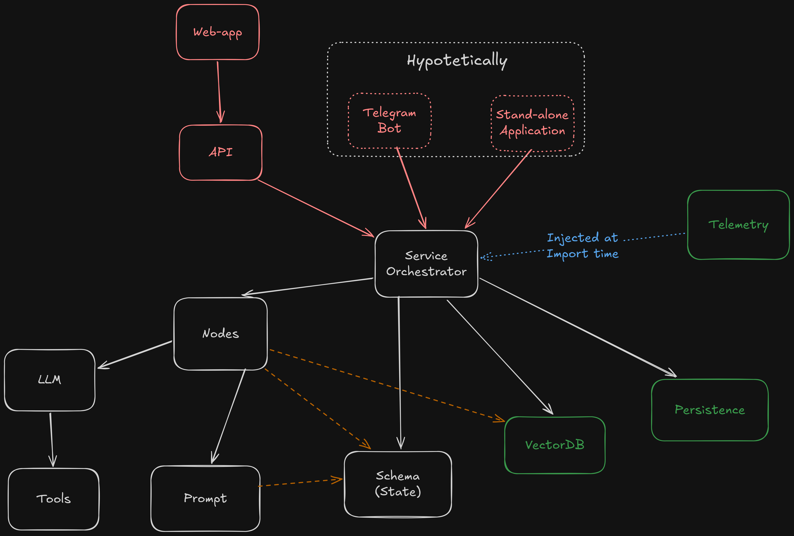

# 🤖 Chatbot Architecture

The orchestration module coordinates how a user request moves through the chatbot: from receiving the message, through any configured processing and retrieval steps, to generating and returning a response. Its design emphasizes modularity, so the workflow can be adapted and tested without rebuilding the system as a single, tightly coupled component.

## 🧩 Modularity and rapid prototyping

The architecture was designed to be highly modular to support rapid prototyping through experimentation. During development, the team may need to try different models, prompts, retrieval strategies, or processing steps. A modular design makes it easier to change or compare these elements while keeping the rest of the workflow largely intact.

For example, a processing step can be revised or replaced without rewriting unrelated steps. This makes experiments easier to isolate, helps identify which changes affect chatbot behaviour, and reduces the risk that a small change will require modifications throughout a monolithic application.

## 🔗 Why LangGraph was selected

LangGraph was adopted as the main component of the orchestration module because it provides concepts that support this modular approach. In LangGraph, workflows are represented as graphs: **nodes** perform individual tasks, **edges** connect those tasks, and shared **state** carries information through the workflow. Conditional routing can send execution along different paths depending on the state or a decision made during processing.

This also supports **staged processing**, which was part of the original design. Instead of placing the entire workflow in one large function, individual stages can be represented and managed separately. Using LangGraph provided an existing framework for this structure, rather than requiring the project to build its own orchestration system.

## 🗺️ Orchestration diagram

The diagram should show the concepts and processing stages used by the current implementation. Keep it aligned with the actual graph definitions in the code, especially if the workflow changes.

## 📋 Current graphs

The configuration provided so far identifies the following graph:
- `BasicRagGraph`
- `HITS`
- `NudgingItalian`
- `AndreaGraph`

Keep this list synchronized with the graph implementations registered in the project. If more graphs are added, document their names and purpose here.

## 📡 Telemetry

The project uses **Arize Phoenix** to manage chatbot telemetry, with **OpenTelemetry (OTel)** as the instrumentation and tracing backbone. Phoenix supports OpenTelemetry-based tracing for AI applications, allowing operators to inspect execution traces and understand how requests move through instrumented components.

In this project, telemetry includes conversations. As described in the privacy documentation, the telemetry design does not correlate a user’s browser with a conversation ID. Conversation content is still collected, so telemetry data should be handled in accordance with the project’s privacy requirements.

## 💾 Persistence

The relational database backend depends on the environment:

- **Development:** SQLite is used for local development. Its database file path is configured with `API_SQLITE_PATH`.
- **Production:** PostgreSQL is used as the relational database. Configure its connection details, including the database host, port, name, credentials, and SSL setting, using the relevant `API_DATABASE_*` variables.

These settings configure the relational database connection. They should be kept consistent with the environment in which the chatbot is running.